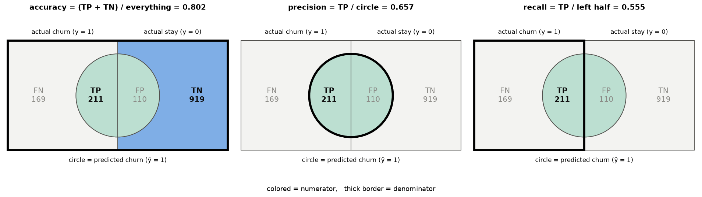
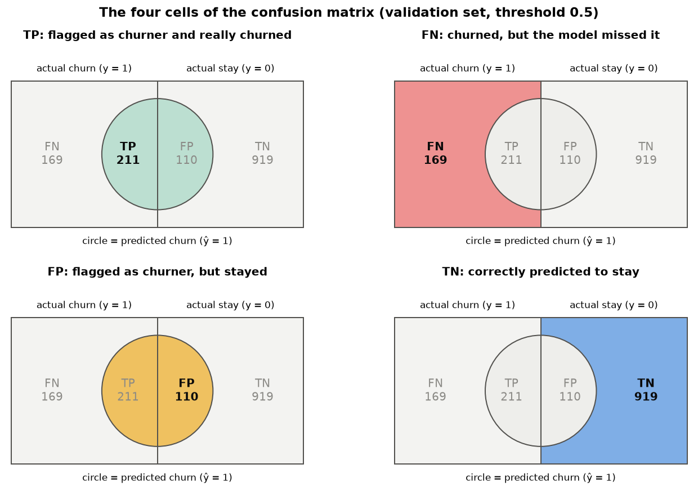
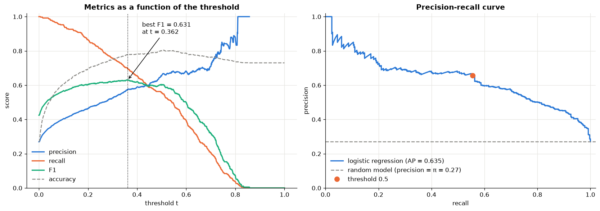
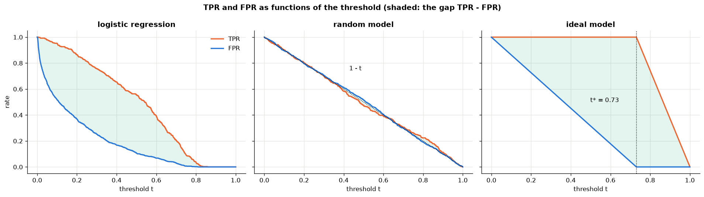
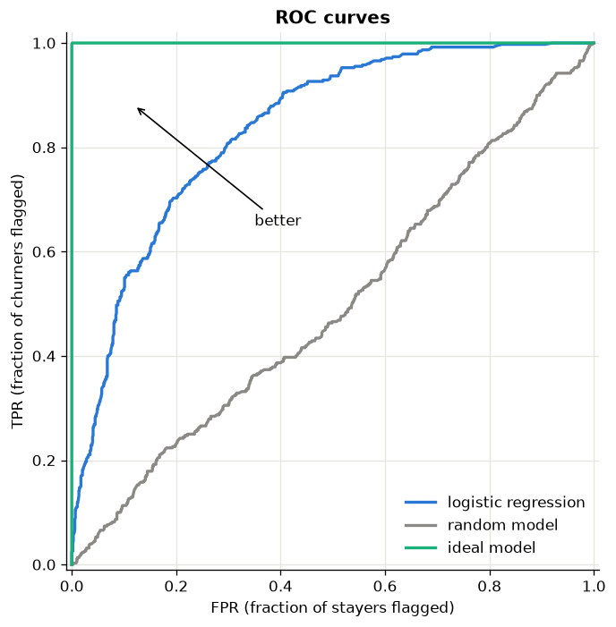
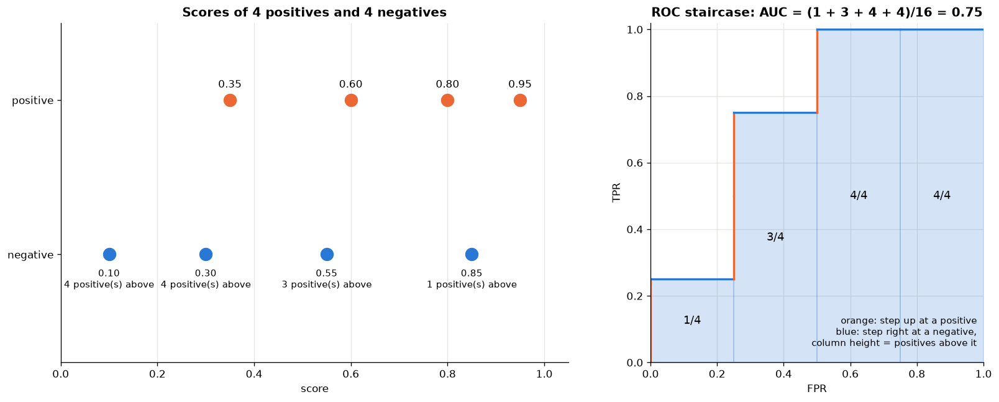
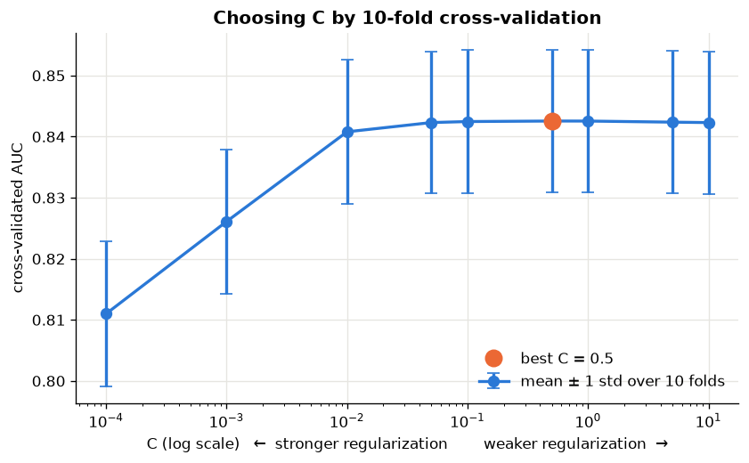

# 🎯 Evaluation Metrics for Binary Classification


*How good is my classifier, really?* This hands-on tutorial answers that question for a real problem: predicting which customers of a telecom company will **churn**. Each metric comes with **intuition, math, code written from scratch and checked against scikit-learn, and visualizations**. Common questions are answered along the way, e.g. *why is AUC a probability?* or *why don't MNIST papers report precision and recall?*

> 👉 **Start here:** [`evaluation_metrics_binary_classification.ipynb`](evaluation_metrics_binary_classification.ipynb)

<p align="center">
  
</p>

---

## 📚 What you will learn

| # | Topic | Highlights |
|---|-------|------------|
| 3 | **Accuracy** | The decision threshold, and the **accuracy paradox**: a model that learned nothing scores 73 % |
| 4 | **Confusion matrix** | TP / TN / FP / FN as Venn-style diagrams; one-vs-rest confusion matrices for multiclass problems |
| 5 | **Precision, recall, F1** | A 100 %-precise but useless model, a 100 %-recall but useless model, the PR curve, choosing the threshold from business costs ($t^* = c_{FP}/(c_{FP}+c_{FN})$) |
| 5.3 | **Q & A** | Precision vs. accuracy · can accuracy be computed from precision and recall? · what $1-\text{precision}$ means · should we drop accuracy? · per-class accuracy vs. precision on MNIST |
| 6 | **ROC curve** | TPR and FPR built from scratch; why FPR should fall faster than TPR (Youden's J) |
| 7 | **Random and ideal models** | Why a random model's ROC curve is the diagonal ($\text{TPR} = \text{FPR} = 1 - t$) |
| 8 | **AUC** | A **proof** that $\text{AUC} = P(S_+ > S_-)$, verified by Monte Carlo, all-pairs counting and the Mann-Whitney U test |
| 9 | **k-fold cross-validation** | Mean ± std of the AUC, tuning the regularization `C`, final test evaluation, *when* to use k-fold |
| 10 | **Cheat sheet** | All metrics, their formulas, and their pitfalls in one table |

## 🖼️ A few figures from the notebook

| The four cells of the confusion matrix | Metrics vs. threshold & precision-recall curve |
|:---:|:---:|
|  |  |
| **TPR & FPR for the model, a random and an ideal model** | **ROC curves** |
|  |  |

**Why is AUC the probability that a random positive outscores a random negative?** Sweep the threshold from high to low. The ROC curve steps up at every positive and right at every negative, and each column under the curve is as high as the number of positives ranked above that negative:

<p align="center">
  
</p>

## 📊 Results

Logistic regression on the Telco churn data, `C` chosen by 10-fold cross-validation (CV AUC **0.843 ± 0.012**), evaluated once on a held-out test set of 1,409 customers:

| Model | Accuracy | Precision | Recall | F1 | ROC AUC |
|-------|:--------:|:---------:|:------:|:--:|:-------:|
| Baseline (always predict "stays") | 0.753 | 0.000 | 0.000 | 0.000 | 0.500 |
| **Logistic regression** (threshold 0.5) | **0.813** | 0.631 | 0.589 | 0.609 | **0.858** |

<p align="center">
  
</p>

## 🗂️ Project structure

```
.
├── evaluation_metrics_binary_classification.ipynb   # The tutorial notebook (executed, with all outputs)
├── data/
│   └── churn_telco_data.csv                         # Telco Customer Churn dataset (7,043 customers × 21 columns)
├── images/                                          # Figures used in this README (generated by the notebook)
├── requirements.txt
├── LICENSE
└── README.md
```

## 🚀 Getting started

```bash
# 1. Clone the repository
git clone https://github.com/s110m/evaluation-metrics-binary-classification.git
cd evaluation-metrics-binary-classification

# 2. Create and activate a virtual environment
python -m venv .venv
source .venv/bin/activate        # Windows: .venv\Scripts\activate

# 3. Install the dependencies
pip install -r requirements.txt

# 4. Launch Jupyter and open the notebook
jupyter notebook
```

The notebook runs from top to bottom in about a minute on a laptop. All random operations use a fixed seed, so you will get the same numbers as shown here (up to tiny differences between library versions).

## 📦 Dataset

The **[Telco Customer Churn](https://www.kaggle.com/datasets/blastchar/telco-customer-churn)** dataset was originally published by IBM as a sample dataset and is distributed on Kaggle. Each row is one customer, described by demographics, account information (tenure, contract, payment method, charges), the services they use, and the target `Churn` (`Yes` / `No`). About 27 % of the customers churn, which makes it a good example of a moderately **imbalanced** problem.

For the data preparation and exploratory analysis of the same dataset, see the companion project **[churn-prediction-binary-classification](https://github.com/s110m/churn-prediction-binary-classification)**.

## 📖 References

- T. Fawcett (2006). *An introduction to ROC analysis.* Pattern Recognition Letters 27, 861–874.
- J. A. Hanley & B. J. McNeil (1982). *The meaning and use of the area under a receiver operating characteristic (ROC) curve.* Radiology 143, 29–36.
- scikit-learn user guide: [Metrics and scoring](https://scikit-learn.org/stable/modules/model_evaluation.html), [Cross-validation](https://scikit-learn.org/stable/modules/cross_validation.html).

## 📄 License

The code in this repository is released under the [MIT License](LICENSE). The dataset belongs to its original authors (IBM); see the Kaggle page for its terms.
